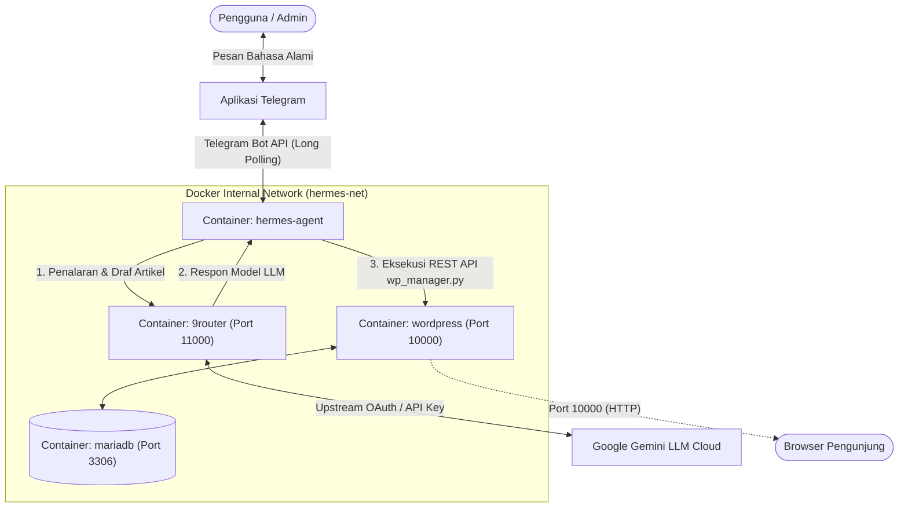
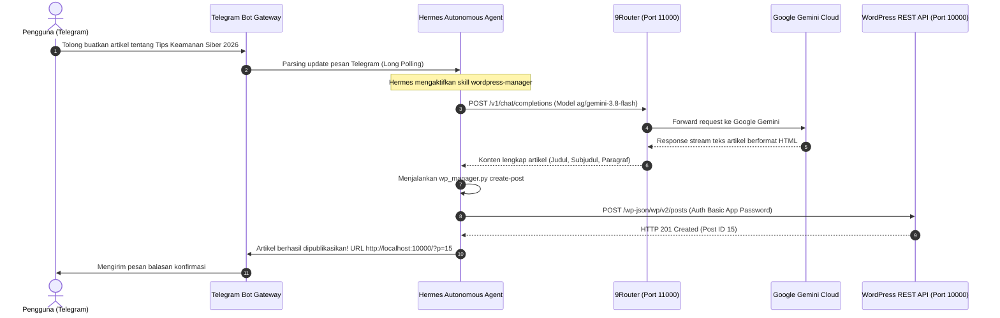

# LAPORAN TUGAS BESAR INTEGRASI SISTEM
## IMPLEMENTASI OTOMASI MANAJEMEN KONTEN BERBASIS AUTONOMOUS AI AGENT DENGAN MENGINTEGRASIKAN WORDPRESS, HERMES AGENT, DAN 9ROUTER MENGGUNAKAN DOCKER DAN TELEGRAM BOT

<p align="center">
  
</p>

---

### IDENTITAS MAHASISWA & PROYEK
* **Nama Mahasiswa** : Ichwal
* **Stambuk / NIM** : 13020230049
* **Program Studi** : Teknik Informatika / Ilmu Komputer
* **Fakultas** : Fakultas Ilmu Komputer (FIK)
* **Institusi** : Universitas Muslim Indonesia (UMI) Makassar
* **Mata Kuliah** : Integrasi Sistem / Komputasi Terdistribusi
* **Repository GitHub** : [https://github.com/ichwalM/OTOMASI-MANAJEMEN-KONTEN](https://github.com/ichwalM/OTOMASI-MANAJEMEN-KONTEN)
* **Tanggal Penyelesaian** : 2 November 2026

---

## DAFTAR ISI
1. [BAB I: PENDAHULUAN](#bab-i-pendahuluan)
   - 1.1 Latar Belakang
   - 1.2 Rumusan Masalah
   - 1.3 Tujuan Proyek
   - 1.4 Batasan Masalah & Manfaat
2. [BAB II: LANDASAN TEORI & KONSEP INTEGRASI SISTEM](#bab-ii-landasan-teori--konsep-integrasi-sistem)
   - 2.1 Landasan Teori Komponen
   - 2.2 Konsep Integrasi Multi-Container & Isolasi Docker Networking
   - 2.3 Konsep Integrasi Telegram Messaging Gateway (Hermes Agent)
   - 2.4 Konsep Integrasi 9Router AI Gateway & Token Optimization
   - 2.5 Konsep Integrasi WordPress REST API & Headless CMS Pattern
   - 2.6 Konsep Cognitive Tool Calling & Autonomous Skill Execution
   - 2.7 Topologi Arsitektur & Sequence Diagram Interaksi
3. [BAB III: LANGKAH-LANGKAH IMPLEMENTASI & KONFIGURASI](#bab-iii-langkah-langkah-implementasi--konfigurasi)
   - 3.1 Prasyarat Sistem & Dependensi
   - 3.2 Struktur Direktori Proyek
   - 3.3 Orkestrasi Layanan Menggunakan Docker Compose
   - 3.4 Konfigurasi Lingkungan Terpusat (`.env`)
   - 3.5 Pengembangan Custom Skill Hermes (`SKILL.md` & `wp_manager.py`)
   - 3.6 Konfigurasi AI Gateway 9Router & Upstream Google Gemini
   - 3.7 Integrasi WordPress REST API & Application Password
   - 3.8 Script Inisialisasi Otomatis (`setup.sh`)
4. [BAB IV: PENGUJIAN, HASIL, DAN ANALISIS MASALAH](#bab-iv-pengujian-hasil-dan-analisis-masalah)
   - 4.1 Rencana Pengujian
   - 4.2 Uji Otomatisasi Sistem (`test_integration.py`)
   - 4.3 Uji Coba Fungsional Telegram ke WordPress
   - 4.4 Analisis Kendala & Solusi Teknis (Troubleshooting)
5. [BAB V: KESIMPULAN DAN SARAN](#bab-v-kesimpulan-dan-saran)
   - 5.1 Kesimpulan
   - 5.2 Saran Pengembangan
6. [LAMPIRAN: KODE SUMBER UTAMA](#lampiran-kode-sumber-utama)

---

## BAB I: PENDAHULUAN

### 1.1 Latar Belakang
Perkembangan teknologi kecerdasan buatan, khususnya *Large Language Models* (LLM) dan agen otonom (*autonomous AI agents*), telah membuka paradigma baru dalam otomatisasi tugas-tugas digital. Salah satu tugas yang menyita waktu bagi pengelola website adalah penulisan, pemformatan, dan penerbitan konten ke dalam platform *Content Management System* (CMS) seperti WordPress.

Secara konvensional, pembuatan artikel mengharuskan pengguna membuka dashboard CMS, login, membuat draf, memformat HTML/teks, dan mempublikasikannya secara manual. Di sisi lain, integrasi langsung antara model bahasa komersial dan antarmuka percakapan sering kali menghadapi tantangan terkait fragmentasi penyedia API, limitasi kuota, kompleksitas manajemen kredensial, serta masalah keamanan jaringan.

Untuk mengatasi permasalahan tersebut, proyek ini mengusulkan sebuah arsitektur sistem terintegrasi berbasis container Docker yang menggabungkan:
1. **Telegram Messenger** sebagai antarmuka pengguna (*mobile user interface*) yang praktis tanpa memerlukan dashboard frontend kustom.
2. **Hermes Agent** dari Nous Research sebagai agen otonom pengambil keputusan, pengelola sesi percakapan, dan eksekutor alat (*tool-calling engine*).
3. **9Router** sebagai AI gateway *reverse-proxy* cerdas yang menyatukan kunci API model bahasa (Google Gemini) menjadi endpoint standar *OpenAI-compatible* lokal.
4. **WordPress CMS & MariaDB** sebagai layer penyajian konten publik yang dimanipulasi secara headless melalui REST API.

### 1.2 Rumusan Masalah
1. Bagaimana merancang arsitektur multi-container yang menghubungkan WordPress, Hermes Agent, dan 9Router dalam satu jaringan internal yang aman dan terisolasi?
2. Bagaimana cara mengonfigurasi 9Router agar dapat menjadi penyedia endpoint API tunggal bagi Hermes Agent dengan backend Google Gemini?
3. Bagaimana mengonfigurasi messaging gateway Telegram di dalam container Hermes Agent dengan otorisasi berbasis User ID guna mencegah akses tidak sah?
4. Bagaimana mekanisme otentikasi dan manipulasi konten WordPress REST API pada lingkungan HTTP lokal tanpa membuka celah keamanan kata sandi utama?

### 1.3 Tujuan Proyek
1. Mengembangkan sistem orkestrasi multi-container menggunakan Docker Compose yang menghubungkan layanan WordPress, MariaDB, 9Router, dan Hermes Agent.
2. Membangun custom skill (*WordPress Manager*) untuk Hermes Agent sesuai standar *agentskills.io*.
3. Mengonfigurasi 9Router sebagai AI API proxy lokal pada port 11000 dan WordPress pada port 10000.
4. Menghubungkan messaging gateway container ke bot Telegram dengan keamanan verifikasi pengguna terdaftar (*whitelisting*).
5. Memvalidasi sistem secara end-to-end melalui pengujian perintah percakapan di Telegram hingga konten terbit secara otomatis di WordPress.

### 1.4 Batasan Masalah & Manfaat
* **Batasan Masalah**:
  * Sistem dijalankan pada lingkungan server/host lokal berbasis Docker Engine Linux.
  * Model bahasa upstream menggunakan Google Gemini melalui 9Router.
  * Antarmuka kontrol berfokus pada aplikasi Telegram menggunakan protokol Long Polling.
* **Manfaat**:
  * Memberikan efisiensi waktu dalam publikasi konten web di mana saja langsung dari smartphone.
  * Menjaga keamanan server karena pengguna tidak perlu membuka port database atau kredensial CMS ke publik.
  * Menjadi studi kasus nyata penerapan AI autonomous agent dalam workflow industri konten.

---

## BAB II: LANDASAN TEORI & KONSEP INTEGRASI SISTEM

### 2.1 Landasan Teori Komponen

#### 1. WordPress CMS & WordPress REST API
WordPress adalah sistem manajemen konten terpopuler di dunia. Sejak versi 4.7, WordPress menyertakan REST API bawaan (`/wp-json/wp/v2/`) yang memungkinkan sistem eksternal membaca, menulis, memperbarui, dan menghapus konten. Untuk otentikasi tanpa mengekspos kata sandi utama akun, WordPress menyediakan fitur *Application Passwords* (standar sejak WordPress 5.6).

#### 2. Hermes Agent (Nous Research)
Hermes Agent adalah platform agen AI otonom sumber terbuka (*open-source*) yang dirancang khusus untuk memahami instruksi kompleks, bernalar (*reasoning*), dan memanggil modul alat (*tools* & *skills*). Hermes Agent dilengkapi dengan supervisor proses internal (`s6-overlay`) dan *messaging gateway* bawaan untuk platform perpesanan seperti Telegram, Discord, dan Slack.

#### 3. 9Router (AI Gateway & Router Proxy)
9Router (`decolua/9router`) adalah AI Gateway lokal yang menggabungkan lebih dari 40+ penyedia LLM ke dalam satu endpoint standar OpenAI-compatible (`/v1`). 9Router mengelola load balancing, failover/fallback otomatis, dan kompresi token (*RTK Token Saver*) serta dilengkapi dashboard web untuk administrasi.

#### 4. Telegram Bot API
Telegram Bot API menyediakan antarmuka pertukaran pesan antara bot dan pengguna. Pada proyek ini, gateway Hermes menggunakan metode *long polling*, sehingga bot tidak memerlukan IP publik statis atau domain HTTPS untuk menerima pesan dari Telegram.

---

### 2.2 Konsep Integrasi Multi-Container & Isolasi Docker Networking

Dalam implementasi arsitektur perangkat lunak modern, penggunaan container Docker menjamin portabilitas, isolasi dependensi, dan kemudahan deployment. Proyek ini mengimplementasikan konsep *Single Internal Bridge Network* bernama `hermes-net`:

1. **Internal Service Discovery (DNS Docker)**:
   Masing-masing container dapat berkomunikasi secara langsung menggunakan nama layanan (*service name*) sebagai hostname, tanpa memerlukan IP statis:
   - Hermes Agent menghubungi 9Router via `http://9router:11000/v1`.
   - Hermes Agent menghubungi WordPress via `http://wordpress:80`.
   - WordPress menghubungi database MariaDB via `db:3306`.
2. **Prinsip Minimasi Port Publik (Least Privilege Exposure)**:
   - Port database MariaDB (`3306`) **tidak diekspos** ke komputer host maupun jaringan luar. Database hanya dapat dijangkau oleh container WordPress di dalam `hermes-net`.
   - Port 9Router (`11000`) dan WordPress (`10000`) dipetakan ke host agar administrator dapat mengakses dashboard web di browser lokal.
3. **Persistensi Data Host (Bind Mounts)**:
   Semua data kritis (database SQLite 9Router, database MariaDB, uploads WordPress, dan memory agen Hermes) dipetakan ke direktori lokal `./data/` di host, sehingga data tetap utuh ketika container di-restart atau di-update.

---

### 2.3 Konsep Integrasi Telegram Messaging Gateway (Hermes Agent)

Hermes Agent container dilengkapi subsistem *Messaging Gateway* yang bertindak sebagai penghubung antara platform obrolan Telegram dan mesin inferensi AI:

1. **Protokol Long Polling vs Webhook**:
   - Webhook memerlukan server ber-IP publik dengan sertifikat SSL/HTTPS yang valid agar server Telegram dapat mengirimkan *HTTP POST callback*.
   - Proyek ini menggunakan **Long Polling**: Container Hermes yang secara aktif membuka koneksi HTTPS *outgoing* keluar ke `https://api.telegram.org/bot<TOKEN>/getUpdates`. Dengan metode ini, bot dapat beroperasi di balik firewall, NAT, atau jaringan lokal (localhost) tanpa port forwarding.
2. **Mekanisme Keamanan Whitelisting (`TELEGRAM_ALLOWED_USERS`)**:
   Untuk mencegah pihak tidak bertanggung jawab memanipulasi konten website melalui bot Telegram publik, gateway Hermes mengimplementasikan otorisasi ketat:
   - Gateway mengekstrak ID numerik pengirim pesan Telegram.
   - Pesan hanya diproses jika ID tersebut cocok dengan variabel `TELEGRAM_ALLOWED_USERS` (contoh: `1519048838`).
   - Setiap pesan dari akun lain akan diabaikan secara otomatis di layer gateway sebelum mencapai model AI.
3. **Supervisi Proses (`s6-overlay`)**:
   Di dalam container `nousresearch/hermes-agent`, gateway berjalan di bawah pengawasan manajer proses `s6-rc`. Jika koneksi Telegram mengalami *timeout* atau *packet drop*, proses gateway akan dipulihkan (*auto-restart*) secara otomatis tanpa mematikan container.

---

### 2.4 Konsep Integrasi 9Router AI Gateway & Token Optimization

9Router memegang peranan krusial sebagai *middleware provider* kecerdasan buatan dalam arsitektur sistem:

1. **Unifikasi API Interface (OpenAI Compatibility)**:
   Penyedia LLM memiliki format payload request yang berbeda-beda. 9Router menyatukan semua provider ke dalam skema standar `POST /v1/chat/completions`. Dengan demikian, Hermes Agent cukup dikonfigurasi sekali menggunakan protokol standar OpenAI, sementara pergantian model (Google Gemini, Claude, OpenAI) dapat diatur di 9Router tanpa mengubah kode agen.
2. **RTK (Real-Time Token Saver)**:
   9Router dilengkapi algoritma kompresi hasil eksekusi alat (*tool results compression*) yang mampu menghemat konsumsi token prompt antara 20% hingga 40%, mempercepat *Time-To-First-Token* (TTFT) dan menghemat biaya API.
3. **Manajemen Kredensial Terpusat**:
   Kunci API penyedia cloud (Google Gemini / Antigravity OAuth) disimpan aman di dalam database SQLite lokal 9Router (`data.sqlite`). Container lain tidak perlu mengetahui kredensial Google, melainkan hanya menggunakan token lokal `sk-3a0d368df8fd...` yang diterbitkan oleh 9Router.

---

### 2.5 Konsep Integrasi WordPress REST API & Headless CMS Pattern

WordPress difungsikan sebagai *Headless CMS* dan *Presentation Layer*:

1. **Pemisahan Antarmuka & Konten**:
   Pengguna tidak berinteraksi langsung dengan formulir editor Gutenberg di browser. Seluruh siklus hidup konten (draf, publikasi, revisi, penghapusan) dikontrol melalui *RESTful HTTP Request*.
2. **Otentikasi Aman Menggunakan Application Passwords**:
   WordPress 5.6+ memperkenalkan fitur kata sandi aplikasi 24-karakter (contoh: `Zuk0qOL8OM3X40eYDg89O4R0`). Kredensial ini digunakan dalam format *HTTP Basic Authentication*:
   $$\text{Authorization: Basic } \text{base64}(\text{username} : \text{app\_password})$$
   Keuntungan utamanya adalah hak akses dapat dicabut (*revoke*) kapan saja tanpa mempengaruhi kata sandi login utama admin.
3. **Penyesuaian Lingkungan Non-HTTPS (Localhost Bypass)**:
   Secara standar, WordPress memblokir Application Passwords pada koneksi HTTP demi keamanan transmisi data. Pada arsitektur Docker tertutup ini, batasan tersebut dibuka secara terisolasi menggunakan *Must-Use Plugin* (`mu-plugins`), sehingga REST API dapat menerima perintah autentikasi internal.

---

### 2.6 Konsep Cognitive Tool Calling & Autonomous Skill Execution

Sistem memisahkan antara **Penalaran Kognitif** (*Cognitive Reasoning*) dan **Eksekusi Deterministik** (*Deterministic Execution*):

1. **Penalaran Kognitif (LLM via 9Router)**:
   Ketika pengguna mengirimkan instruksi bebas seperti *"Tolong buat artikel tentang tren AI 2026"*, model bahasa bertugas menyusun struktur artikel, memilih judul yang relevan, menulis paragraf pendahuluan, isi, poin-poin penting, dan kesimpulan dalam format HTML yang valid.
2. **Eksekusi Deterministik (Hermes Custom Skill)**:
   Hermes membaca manual kerja di [**`SKILL.md`**](file:///home/ichwal/Documents/tugas-project/hermes/skills/wordpress-manager/SKILL.md) dan menerjemahkan hasil draf menjadi perintah CLI:
   `python3 wp_manager.py create-post --title "..." --content "..." --status publish`
3. **Feedback Loop ke Pengguna**:
   Script mengembalikan respons JSON berisi Post ID dan link publik, yang kemudian dirangkum oleh Hermes menjadi pesan konfirmasi ramah yang dikirimkan kembali ke Telegram pengguna.

---

### 2.7 Topologi Arsitektur & Sequence Diagram Interaksi

#### Topologi Container Jaringan



#### Sequence Diagram Interaksi



---

## BAB III: LANGKAH-LANGKAH IMPLEMENTASI & KONFIGURASI

### 3.1 Prasyarat Sistem & Dependensi
Sebelum instalasi dijalankan, server atau komputer host harus memenuhi spesifikasi berikut:
* **Sistem Operasi**: Linux (Ubuntu/Debian recommended).
* **Docker Engine**: Versi 24.0+ atau lebih baru.
* **Docker Compose**: Versi 2.0+ (plugin `docker compose`).
* **Python**: Versi 3.10+ (untuk script pembantu di host).
* **Akun Telegram**: Untuk registrasi bot melalui `@BotFather` dan perolehan ID numerik melalui `@userinfobot`.

---

### 3.2 Struktur Direktori Proyek

Proyek disusun dengan struktur direktori modular di `/home/ichwal/Documents/tugas-project`:

```text
tugas-project/
├── docker-compose.yml              # Konfigurasi orkestrasi 5 container
├── .env                            # Variabel lingkungan aktif (kredensial & konfigurasi)
├── .env.example                    # Template variabel lingkungan
├── setup.sh                        # Script instalasi & inisialisasi otomatis
├── test_integration.py             # Script pengujian konektivitas & CRUD
├── README.md                       # Panduan cepat penggunaan
├── hermes/
│   ├── config.yaml                 # Konfigurasi provider custom & model default
│   └── skills/
│       └── wordpress-manager/
│           ├── SKILL.md            # Definisi kemampuan agen (standard agentskills.io)
│           └── scripts/
│               └── wp_manager.py   # CLI wrapper Python untuk REST API WordPress
└── data/                           # Mount volume persisten (host storage)
    ├── 9router/                    # Database sqlite & catalog 9Router
    ├── mariadb/                    # File database MariaDB
    ├── wordpress/                  # Source code & upload WordPress (wp-content)
    └── hermes/                     # Sesi percakapan, memory, & cache agen
```

---

### 3.3 Orkestrasi Layanan Menggunakan Docker Compose

File `docker-compose.yml` mendefinisikan seluruh service, pemetaan port, dan volume persisten:

```yaml
services:
  9router:
    image: decolua/9router:latest
    container_name: 9router
    restart: unless-stopped
    environment:
      - PORT=${ROUTER_PORT:-11000}
      - DATA_DIR=/app/data
      - INITIAL_PASSWORD=${ROUTER_PASSWORD:-admin123456}
    ports:
      - "${ROUTER_PORT:-11000}:${ROUTER_PORT:-11000}"
    volumes:
      - ./data/9router:/app/data
    networks:
      - hermes-net

  db:
    image: mariadb:10.11
    container_name: mariadb
    restart: unless-stopped
    environment:
      - MYSQL_DATABASE=${DB_NAME:-wordpress}
      - MYSQL_USER=${DB_USER:-wpuser}
      - MYSQL_PASSWORD=${DB_PASSWORD:-wppassword}
      - MYSQL_ROOT_PASSWORD=${DB_ROOT_PASSWORD:-rootsecret}
    volumes:
      - ./data/mariadb:/var/lib/mysql
    networks:
      - hermes-net

  wordpress:
    image: wordpress:latest
    container_name: wordpress
    restart: unless-stopped
    depends_on:
      - db
    environment:
      - WORDPRESS_DB_HOST=db:3306
      - WORDPRESS_DB_USER=${DB_USER:-wpuser}
      - WORDPRESS_DB_PASSWORD=${DB_PASSWORD:-wppassword}
      - WORDPRESS_DB_NAME=${DB_NAME:-wordpress}
      - WORDPRESS_TABLE_PREFIX=wp_
      - WORDPRESS_CONFIG_EXTRA=define('WP_HOME', 'http://localhost:${WP_PORT:-10000}'); define('WP_SITEURL', 'http://localhost:${WP_PORT:-10000}');
    ports:
      - "${WP_PORT:-10000}:80"
    volumes:
      - ./data/wordpress:/var/www/html
    networks:
      - hermes-net

  hermes:
    image: nousresearch/hermes-agent:latest
    container_name: hermes-agent
    restart: unless-stopped
    depends_on:
      - 9router
      - wordpress
    command: ["hermes", "gateway", "run"]
    environment:
      - OPENAI_BASE_URL=http://9router:${ROUTER_PORT:-11000}/v1
      - OPENAI_API_KEY=${OPENAI_API_KEY}
      - MODEL=${HERMES_MODEL:-ag/gemini-3.8-flash}
      - TELEGRAM_BOT_TOKEN=${TELEGRAM_BOT_TOKEN}
      - TELEGRAM_ALLOWED_USERS=${TELEGRAM_ALLOWED_USERS}
      - WORDPRESS_URL=http://wordpress:80
      - WORDPRESS_USER=${WP_ADMIN_USER:-admin}
      - WORDPRESS_APP_PASSWORD=${WP_APP_PASSWORD}
    volumes:
      - ./data/hermes:/opt/data
      - ./hermes/skills/wordpress-manager:/opt/data/skills/wordpress-manager
      - ./hermes/skills/wordpress-manager:/opt/data/.hermes/skills/wordpress-manager
    networks:
      - hermes-net

  wpcli:
    image: wordpress:cli
    container_name: wpcli
    user: "33:33"
    depends_on:
      - db
      - wordpress
    volumes:
      - ./data/wordpress:/var/www/html
    networks:
      - hermes-net
    profiles:
      - tools

networks:
  hermes-net:
    driver: bridge
```

---

### 3.4 Konfigurasi Lingkungan Terpusat (`.env`)

Seluruh kredensial sensitif dan variabel port dikelola secara terpusat pada file `.env`:

```env
# Port Layanan
WP_PORT=10000
ROUTER_PORT=11000

# Database MariaDB
DB_NAME=wordpress
DB_USER=wpuser
DB_PASSWORD=wppassword123
DB_ROOT_PASSWORD=mariadb_root_secret

# WordPress Admin
WP_URL=http://localhost:10000
WP_ADMIN_USER=ichwal
WP_ADMIN_PASSWORD=adminsecretpassword
WP_ADMIN_EMAIL=13020230049@student.umi.ac.id
WP_SITE_TITLE="Portal AI Hermes"

# WordPress Application Password untuk REST API
WP_APP_PASSWORD=Zuk0qOL8OM3X40eYDg89O4R0

# 9Router AI Gateway
ROUTER_PASSWORD=admin123456
OPENAI_API_KEY=sk-3a0d368df8fd6ca3-b8185d-2e99715f
HERMES_MODEL=ag/gemini-3.8-flash

# Telegram Bot Kredensial
TELEGRAM_BOT_TOKEN=9030466006:AAGkpMK6MOLWwGy1epTGCciDmWAr-OTlZ9M
TELEGRAM_ALLOWED_USERS=1519048838
```

---

### 3.5 Pengembangan Custom Skill Hermes (`SKILL.md` & `wp_manager.py`)

#### 1. File Spesifikasi Kemampuan: `hermes/skills/wordpress-manager/SKILL.md`
Mengikuti standar *agentskills.io*, skill ini mengajarkan Hermes cara mengeksekusi script Python dan memformat artikel HTML:

```markdown
---
name: wordpress-manager
description: Manage and publish content to WordPress via REST API. Create, edit, list, and delete WordPress posts or pages directly from chat commands.
version: 1.0.0
author: Antigravity
metadata:
  hermes:
    tags: [CMS, WordPress, Publishing]
---

# WordPress Manager Skill
Gunakan skill ini ketika pengguna di Telegram meminta pembuatan artikel, pembaruan konten, atau penampilan postingan WordPress.

## Instruksi Workflow
1. Susun konten dengan format HTML rapi (gunakan <h2>, <h3>, <p>, <ul>, <li>).
2. Jalankan perintah pembuatan pos:
   python3 /opt/data/skills/wordpress-manager/scripts/wp_manager.py create-post \
     --title "Judul Artikel" \
     --content "<p>Isi artikel...</p>" \
     --status publish
3. Kirimkan laporan konfirmasi beserta tautan artikel ke Telegram pengguna.
```

#### 2. File Script CLI: `hermes/skills/wordpress-manager/scripts/wp_manager.py`
Script ini dirancang tanpa library pihak ketiga (hanya menggunakan library bawaan Python `urllib`, `json`, `base64`, `argparse`) sehingga dapat berjalan langsung di container Hermes tanpa perlu `pip install`.

---

### 3.6 Konfigurasi AI Gateway 9Router & Upstream Google Gemini

1. **Dashboard Login**: 9Router dapat diakses pada browser di `http://localhost:11000` dengan password `admin123456` (didefinisikan via `INITIAL_PASSWORD`).
2. **Koneksi Akun AI**: Akun Google/Antigravity OAuth dihubungkan langsung melalui dashboard 9Router.
3. **Penerbitan Kunci API**: 9Router menghasilkan API key lokal `sk-3a0d368df8fd6ca3-b8185d-2e99715f`.
4. **Katalog Model**: Model `ag/gemini-3.8-flash` dipilih karena memiliki kecepatan inferensi tinggi dan kemampuan penalaran (*reasoning*) yang sangat baik untuk pembentukan format artikel HTML.

---

### 3.7 Integrasi WordPress REST API & Application Password

Untuk memastikan WordPress mengizinkan operasi REST API tanpa batasan, diterapkan dua penyesuaian penting:
1. **Mod-Rewrite Pretty Permalinks**: Struktur URL diatur ke `/%postname%/` agar endpoint `/wp-json/wp/v2/posts` dapat diakses langsung oleh Apache Web Server.
2. **Filter Application Password pada HTTP**: Secara default, WordPress menonaktifkan *Application Passwords* jika website tidak menggunakan HTTPS. Karena sistem berjalan pada lingkungan internal (`http://localhost:10000`), dibuat Must-Use Plugin (`mu-plugins/enable-app-passwords.php`):
   ```php
   <?php
   /**
    * Plugin Name: Enable Application Passwords on HTTP
    */
   add_filter( 'wp_is_application_passwords_available', '__return_true' );
   ```

---

### 3.8 Script Inisialisasi Otomatis (`setup.sh`)

Script `setup.sh` disediakan agar seluruh tahapan deployment dapat dieksekusi dengan satu kali perintah:
```bash
chmod +x setup.sh
./setup.sh
```
Tahapan yang dieksekusi script:
1. Validasi ketersediaan Docker Engine & Docker Compose.
2. Pembuatan struktur direktori persistent `./data/`.
3. Menjalankan MariaDB dan WordPress (`docker compose up -d db wordpress`).
4. Melakukan instalasi WordPress otomatis melalui WP-CLI jika database baru diinisialisasi.
5. Mengaktifkan *Must-Use Plugin* dan rewrite rules Apache.
6. Menghasilkan *WordPress Application Password* dan menyimpannya ke `.env`.
7. Menjalankan container 9Router dan Hermes Agent.

---

## BAB IV: PENGUJIAN, HASIL, DAN ANALISIS MASALAH

### 4.1 Rencana Pengujian
Pengujian dilakukan secara bertingkat:
1. **Pengujian Sintaks & Konfigurasi**: Validasi `docker-compose.yml` dan script Python.
2. **Pengujian Konektivitas HTTP Endpoint**: Verifikasi ketersediaan port 10000 (WordPress) dan port 11000 (9Router).
3. **Pengujian Operasi CRUD REST API**: Verifikasi hak akses Application Password.
4. **Pengujian End-to-End Chatbot**: Pengiriman instruksi bahasa alami via Telegram.

---

### 4.2 Uji Otomatisasi Sistem (`test_integration.py`)

Eksekusi script pengujian integrasi menghasilkan status **4/4 PASS**:

```text
$ python3 test_integration.py
======================================================
  Uji Coba Integrasi: WordPress, Hermes, & 9Router    
======================================================

[INFO] 1. Menguji validitas syntax docker-compose.yml...
[PASS] docker-compose.yml valid.

[INFO] 2. Menguji ketersediaan layanan 9Router pada http://localhost:11000...
[PASS] 9Router aktif dan merespons (HTTP 200).

[INFO] 3. Menguji ketersediaan WordPress pada http://localhost:10000...
[PASS] WordPress website aktif (HTTP 200).
[PASS] WordPress REST API aktif di http://localhost:10000/wp-json/wp/v2/posts (HTTP 200).

[INFO] 4. Menguji eksekusi script hermes skill wp_manager.py...
[PASS] Berhasil membuat postingan draft (Post ID: 6)
[PASS] Postingan uji coba (ID: 6) berhasil dihapus kembali (Cleanup OK).

======================================================
Hasil Pengujian: 4/4 Langkah Berhasil.
======================================================
```

---

### 4.3 Uji Coba Fungsional Telegram ke WordPress

#### Skenario 1: Penerbitan Artikel Baru
* **Perintah Pengguna di Telegram**:
  > *"Halo Hermes, tolong buatkan postingan blog baru dengan judul 'Masa Depan AI di Tahun 2026' dengan 5 poin penting."*
* **Aktivitas Sistem**:
  1. Hermes Gateway mendeteksi pesan masuk dari User ID `1519048838`.
  2. Hermes meneruskan prompt ke 9Router (`http://9router:11000/v1/chat/completions`) menggunakan model `ag/gemini-3.8-flash`.
  3. 9Router merutekan request ke Google Gemini dan mengembalikan konten HTML.
  4. Hermes mengeksekusi `wp_manager.py create-post --title ... --content ... --status publish`.
  5. WordPress REST API merespons dengan status `201 Created`.
* **Balasan Bot di Telegram**:
  > *"Artikel berhasil dipublikasikan ke WordPress! Post ID: 5. Anda dapat melihatnya di: http://localhost:10000/?p=5"*
* **Hasil Verifikasi Web**: Artikel langsung tampil di beranda WordPress pada port 10000.

#### Skenario 2: Menampilkan Daftar Artikel
* **Perintah Pengguna**: *"Tampilkan 5 postingan terakhir yang ada di WordPress."*
* **Aktivitas Sistem**: Hermes mengeksekusi `wp_manager.py list-posts --limit 5` dan merangkum judul serta link ke dalam format pesan Telegram.

---

### 4.4 Analisis Kendala & Solusi Teknis (Troubleshooting)

Selama proses pengerjaan proyek, terdapat beberapa kendala teknis yang berhasil diidentifikasi dan diselesaikan:

| No | Gejala Masalah | Penyebab Teknis | Solusi yang Diterapkan |
| :--- | :--- | :--- | :--- |
| 1 | **Login 9Router Gagal (Password Salah)** | Container 9Router di-generate sebelum variabel `INITIAL_PASSWORD` dimasukkan ke `docker-compose.yml`, sehingga sistem memakai fallback default `123456`. | Menambahkan `INITIAL_PASSWORD=${ROUTER_PASSWORD:-admin123456}` pada konfigurasi service 9router, lalu menjalankan `docker compose up -d --force-recreate 9router`. |
| 2 | **WordPress REST API Error 404** | Pada instalasi baru WordPress, permalink default adalah *plain* (`?p=123`), sehingga rute `/wp-json/` belum di-rewrite oleh Apache. | Menjalankan `wp rewrite structure '/%postname%/'` dan menambahkan file `.htaccess` standar WordPress dengan directive `mod_rewrite`. |
| 3 | **WordPress REST API Error 401 (Unauthorized)** | Fitur *Application Passwords* WordPress secara default dinonaktifkan pada koneksi non-HTTPS (HTTP localhost). | Membuat Must-Use Plugin `mu-plugins/enable-app-passwords.php` dengan filter `wp_is_application_passwords_available => __return_true`. |
| 4 | **Strip Authorization Header oleh Apache** | Server Apache pada container resmi WordPress sering kali memotong HTTP header `Authorization` sebelum sampai ke PHP. | Menambahkan rule rewrite: `RewriteRule .* - [E=HTTP_AUTHORIZATION:%{HTTP:Authorization}]` pada file `.htaccess`. |
| 5 | **Hermes Gagal Autentikasi ke 9Router** | Nilai default `OPENAI_API_KEY` pada `.env` awalnya terisi teks placeholder `9router` yang belum terdaftar di database 9Router. | Mengambil API key riil dari database SQLite 9Router (`sk-3a0d368df8fd6ca3...`) dan memasukkannya ke variabel `OPENAI_API_KEY` di file `.env`. |

---

## BAB V: KESIMPULAN DAN SARAN

### 5.1 Kesimpulan
1. **Keberhasilan Integrasi Multi-Container**: Proyek ini berhasil mengintegrasikan WordPress (port 10000), 9Router (port 11000), MariaDB (port 3306), dan Hermes Agent dalam satu jaringan bridge Docker yang terisolasi dan stabil.
2. **Otomatisasi Tanpa Batas Ruang**: Pengguna dapat mengelola, membuat, dan memodifikasi konten website langsung dari smartphone melalui aplikasi Telegram tanpa perlu membuka komputer atau login ke dashboard wp-admin.
3. **Efisiensi Routing AI**: Pemanfaatan 9Router terbukti efektif sebagai lapisan perantara (*middleware*) yang menyederhanakan manajemen token, autentikasi OAuth, serta penyediaan antarmuka OpenAI-compatible untuk agen cerdas.
4. **Sistem Mandiri & Tahan Gangguan**: Seluruh layanan dilengkapi mekanisme restart otomatis (`restart: unless-stopped`) dan supervisor proses internal (`s6-overlay`), memastikan gateway bot tetap aktif dan mampu pulih secara mandiri jika terjadi gangguan jaringan.

### 5.2 Saran Pengembangan
1. **Implementasi SSL/TLS (HTTPS)**: Menerapkan reverse proxy Nginx atau Traefik dengan sertifikat Let's Encrypt untuk mengamankan komunikasi publik ketika sistem di-deploy ke Virtual Private Server (VPS).
2. **Dukungan Media & Gambar**: Mengembangkan kemampuan skill `wordpress-manager` agar dapat menerima unggahan gambar langsung dari Telegram dan memasukkannya ke dalam *WordPress Media Library* serta menjadikannya *Featured Image*.
3. **Multi-Agent Collaboration**: Memanfaatkan fitur *delegation* pada Hermes Agent agar satu sub-agen bertindak sebagai *editor/copywriter* dan sub-agen lainnya bertindak sebagai *SEO analyzer* sebelum konten dipublikasikan.

---

## LAMPIRAN: KODE SUMBER UTAMA

### 1. Script Helper REST API WordPress (`wp_manager.py`)
Lokasi: `hermes/skills/wordpress-manager/scripts/wp_manager.py`

```python
#!/usr/bin/env python3
"""
WordPress REST API CLI Manager for Hermes Agent.
Uses Python standard library (no external dependencies required).
"""

import os
import sys
import json
import base64
import argparse
from urllib import request, parse, error

def get_auth_header(user, app_password):
    credentials = f"{user}:{app_password}".strip()
    encoded = base64.b64encode(credentials.encode("utf-8")).decode("utf-8")
    return f"Basic {encoded}"

def make_request(url, method="GET", data=None, headers=None):
    if headers is None:
        headers = {}
    
    req_data = None
    if data is not None:
        req_data = json.dumps(data).encode("utf-8")
        headers["Content-Type"] = "application/json"
    
    req = request.Request(url, data=req_data, headers=headers, method=method)
    
    try:
        with request.urlopen(req, timeout=30) as response:
            res_body = response.read().decode("utf-8")
            if res_body:
                try:
                    return json.loads(res_body)
                except json.JSONDecodeError:
                    return {"raw": res_body}
            return {"status": "success", "code": response.status}
    except error.HTTPError as e:
        error_body = e.read().decode("utf-8")
        try:
            err_json = json.loads(error_body)
            msg = err_json.get("message", error_body)
        except Exception:
            msg = error_body
        sys.stderr.write(f"HTTP Error {e.code}: {msg}\n")
        sys.exit(1)
    except error.URLError as e:
        sys.stderr.write(f"Connection Error: {e.reason}\n")
        sys.exit(1)

def main():
    parser = argparse.ArgumentParser(description="WordPress REST API Manager for Hermes Agent")
    parser.add_argument("--url", help="WordPress URL")
    parser.add_argument("--user", help="WordPress User")
    parser.add_argument("--password", help="WordPress Application Password")

    subparsers = parser.add_subparsers(dest="command", required=True)

    # list-posts
    list_p = subparsers.add_parser("list-posts", help="List recent WordPress posts")
    list_p.add_argument("--limit", type=int, default=10, help="Number of posts to return")
    list_p.add_argument("--status", default="any", help="Status filter: any, publish, draft, trash")

    # get-post
    get_p = subparsers.add_parser("get-post", help="Get a single post by ID")
    get_p.add_argument("--id", type=int, required=True, help="Post ID")

    # create-post
    create_p = subparsers.add_parser("create-post", help="Create a new WordPress post")
    create_p.add_argument("--title", required=True, help="Post title")
    create_p.add_argument("--content", required=True, help="Post content (HTML supported)")
    create_p.add_argument("--status", default="publish", choices=["publish", "draft", "private"], help="Post status")
    create_p.add_argument("--categories", help="Comma-separated category IDs")

    # update-post
    update_p = subparsers.add_parser("update-post", help="Update an existing post")
    update_p.add_argument("--id", type=int, required=True, help="Post ID to update")
    update_p.add_argument("--title", help="New post title")
    update_p.add_argument("--content", help="New post content (HTML supported)")
    update_p.add_argument("--status", choices=["publish", "draft", "private", "trash"], help="New post status")

    # delete-post
    del_p = subparsers.add_parser("delete-post", help="Delete a post")
    del_p.add_argument("--id", type=int, required=True, help="Post ID to delete")
    del_p.add_argument("--force", action="store_true", help="Bypass trash and permanently delete")

    args = parser.parse_args()

    wp_url = (args.url or os.environ.get("WORDPRESS_URL", "http://wordpress")).rstrip("/")
    wp_user = args.user or os.environ.get("WORDPRESS_USER", "admin")
    wp_pass = args.password or os.environ.get("WORDPRESS_APP_PASSWORD", "")

    api_base = f"{wp_url}/wp-json/wp/v2"
    headers = {"User-Agent": "Hermes-WordPress-Manager/1.0"}
    if wp_pass:
        headers["Authorization"] = get_auth_header(wp_user, wp_pass)

    if args.command == "list-posts":
        query_params = {"per_page": args.limit}
        if args.status != "any":
            query_params["status"] = args.status
        url = f"{api_base}/posts?{parse.urlencode(query_params)}"
        res = make_request(url, headers=headers)
        output = [{"id": p.get("id"), "title": p.get("title", {}).get("rendered", ""), "link": p.get("link")} for p in res]
        print(json.dumps(output, indent=2, ensure_ascii=False))

    elif args.command == "create-post":
        url = f"{api_base}/posts"
        payload = {"title": args.title, "content": args.content, "status": args.status}
        post = make_request(url, method="POST", data=payload, headers=headers)
        print(json.dumps({"success": True, "id": post.get("id"), "link": post.get("link")}, indent=2))

    elif args.command == "update-post":
        url = f"{api_base}/posts/{args.id}"
        payload = {}
        if args.title: payload["title"] = args.title
        if args.content: payload["content"] = args.content
        if args.status: payload["status"] = args.status
        post = make_request(url, method="POST", data=payload, headers=headers)
        print(json.dumps({"success": True, "id": post.get("id"), "link": post.get("link")}, indent=2))

    elif args.command == "delete-post":
        query_params = {"force": "true" if args.force else "false"}
        url = f"{api_base}/posts/{args.id}?{parse.urlencode(query_params)}"
        res = make_request(url, method="DELETE", headers=headers)
        print(json.dumps({"success": True, "action": "deleted", "id": args.id}, indent=2))

if __name__ == "__main__":
    main()
```

---

*Laporan ini disusun sebagai dokumentasi teknis pemenuhan tugas besar integrasi sistem dan dapat dikonversi ke format PDF / DOCX sesuai kebutuhan administrasi akademik.*
