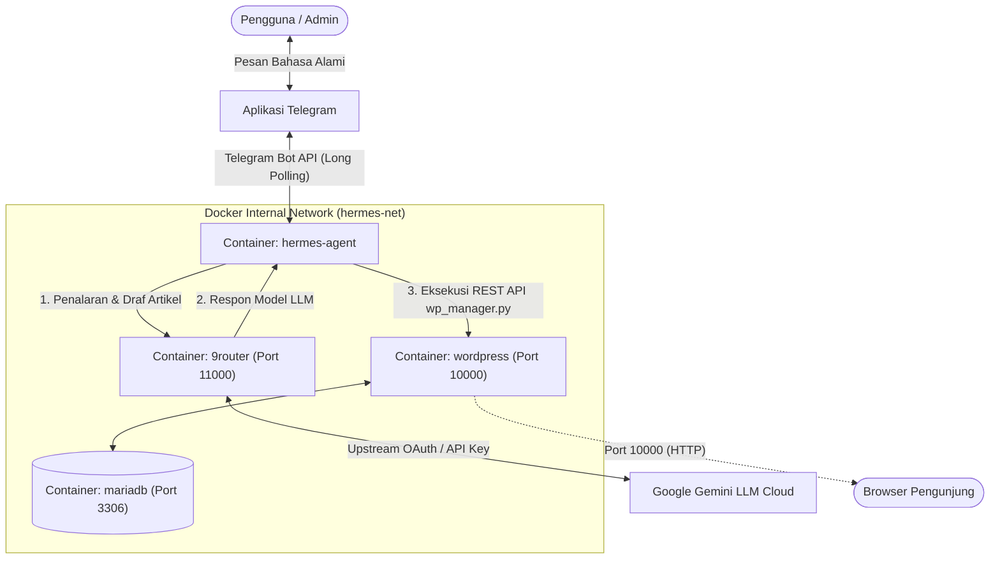
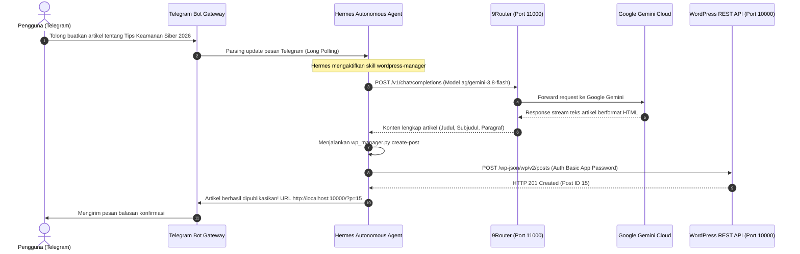

# Otomasi Manajemen Konten WordPress Berbasis Autonomous AI Agent (Hermes & 9Router via Telegram)

[](https://www.docker.com/)
[](https://docs.docker.com/compose/)
[](https://wordpress.org/)
[](https://core.telegram.org/bots)
[](https://www.python.org/)
[](https://github.com/ichwalM/OTOMASI-MANAJEMEN-KONTEN)

Proyek ini mengintegrasikan **WordPress CMS**, **Hermes Agent (Nous Research)**, dan **9Router (AI Gateway Proxy)** ke dalam ekosistem multi-container Docker. Sistem ini memungkinkan pengguna mengontrol, membuat draf, mempublikasikan, merevisi, dan menghapus konten blog WordPress secara langsung melalui percakapan bahasa alami di aplikasi **Telegram**, dengan penalaran model bahasa cerdas (**Google Gemini**) yang di-proxy oleh 9Router.

---

## 📌 Repository GitHub
* **URL Repository**: [https://github.com/ichwalM/OTOMASI-MANAJEMEN-KONTEN](https://github.com/ichwalM/OTOMASI-MANAJEMEN-KONTEN)
* **Clone SSH**: `git clone git@github.com:ichwalM/OTOMASI-MANAJEMEN-KONTEN.git`
* **Clone HTTPS**: `git clone https://github.com/ichwalM/OTOMASI-MANAJEMEN-KONTEN.git`

---

## 📑 Daftar Isi
- [Arsitektur & Konsep Sistem](#-arsitektur--konsep-sistem)
  - [Topologi Jaringan Container](#topologi-jaringan-container)
  - [Alur Interaksi Sistem (Sequence Diagram)](#alur-interaksi-sistem-sequence-diagram)
- [Komponen Utama Sistem](#-komponen-utama-sistem)
- [Port & URL Layanan](#-port--url-layanan)
- [Prasyarat Sistem](#-prasyarat-sistem)
- [Panduan Instalasi & Menjalankan](#-panduan-instalasi--menjalankan)
  - [Langkah 1: Clone Repository](#langkah-1-clone-repository)
  - [Langkah 2: Konfigurasi File .env](#langkah-2-konfigurasi-file-env)
  - [Langkah 3: Jalankan Script Inisialisasi Otomatis](#langkah-3-jalankan-script-inisialisasi-otomatis)
  - [Langkah 4: Login 9Router & Hubungkan Model AI](#langkah-4-login-9router--hubungkan-model-ai)
- [Panduan Perintah Telegram (Cheatsheet)](#-panduan-perintah-telegram-cheatsheet)
- [Struktur Direktori Proyek](#-struktur-direktori-proyek)
- [Pengujian Otomatis (Testing)](#-pengujian-otomatis-testing)
- [Panduan Pemecahan Masalah (Troubleshooting)](#-panduan-pemecahan-masalah-troubleshooting)
- [Dokumentasi Laporan Tugas Akademik](#-dokumentasi-laporan-tugas-akademik)
- [Identitas Pengembang](#-identitas-pengembang)

---

## 🏗 Arsitektur & Konsep Sistem

Sistem ini didesain dengan memisahkan tiga pilar utama:
1. **Antarmuka Pengguna Interaktif**: Telegram Messenger (menggunakan long polling).
2. **Kecerdasan Buatan & Penalaran Alat**: Hermes Agent + 9Router AI Gateway.
3. **Penyajian Konten & Database**: Headless WordPress CMS + MariaDB.

### Topologi Jaringan Container

Seluruh layanan berjalan dalam satu bridge network internal bernama `hermes-net`:



### Alur Interaksi Sistem (Sequence Diagram)



---

## 🧩 Komponen Utama Sistem

1. **Telegram Messaging Gateway (Container `hermes-agent`)**:
   - Berjalan menggunakan protokol **Long Polling**, sehingga bot tidak memerlukan IP publik statis, domain HTTPS, atau port forwarding.
   - Dilengkapi sistem **Whitelisting Akun (`TELEGRAM_ALLOWED_USERS`)** untuk menjamin hanya pengguna pemilik bot yang diizinkan memanipulasi website.
   - Diproteksi oleh supervisor proses `s6-overlay` untuk pemulihan otomatis jika koneksi jaringan terputus.

2. **9Router AI Gateway (Container `9router`)**:
   - Berfungsi sebagai reverse-proxy AI lokal yang menyediakan endpoint standar OpenAI-compatible (`POST /v1/chat/completions`).
   - Menyimpan kredensial upstream (Google Gemini / Antigravity OAuth) secara terisolasi.
   - Mengoptimalkan efisiensi token prompt (*RTK Token Saver*).

3. **WordPress Headless CMS (Container `wordpress` & `mariadb`)**:
   - Menyediakan antarmuka REST API publik pada rute `/wp-json/wp/v2/posts`.
   - Menggunakan otentikasi **Application Passwords** dengan Basic Auth Base64.
   - Dilengkapi *Must-Use Plugin* (`mu-plugins/enable-app-passwords.php`) dan rewrite rules `.htaccess` untuk mengaktifkan Application Passwords di lingkungan HTTP localhost.

4. **Hermes Custom Skill (`wordpress-manager`)**:
   - Mengikuti spesifikasi terbuka `agentskills.io` via file `SKILL.md`.
   - Menjalankan helper script CLI Python murni `wp_manager.py` menggunakan modul bawaan `urllib` (tanpa dependensi eksternal / pip).

---

## 🌐 Port & URL Layanan

| Layanan | Port Host | URL Akses | Kredensial Default |
| :--- | :--- | :--- | :--- |
| **WordPress Web** | `10000` | [http://localhost:10000](http://localhost:10000) | Pengunjung Publik |
| **WordPress Admin** | `10000` | [http://localhost:10000/wp-admin](http://localhost:10000/wp-admin) | User: `ichwal` *(atau di `.env`)* |
| **9Router Dashboard** | `11000` | [http://localhost:11000](http://localhost:11000) | Password: `admin123456` |
| **9Router Endpoint** | `11000` | `http://9router:11000/v1` | Auth: Bearer `sk-3a0d368df8fd...` |
| **MariaDB** | `3306` | *Hanya internal container* | User: `wpuser` |

---

## ⚙️ Prasyarat Sistem

* **Sistem Operasi**: Linux (Ubuntu 20.04/22.04/24.04, Debian 11/12, atau WSL2).
* **Docker Engine**: Versi 24.0+ atau lebih baru.
* **Docker Compose**: Plugin Docker Compose v2 (`docker compose version`).
* **Akun Telegram**:
  1. Buat bot baru di Telegram via **[@BotFather](https://t.telegram.me/BotFather)** (`/newbot`) untuk mendapatkan **Bot Token**.
  2. Cek ID numerik akun Anda di Telegram via **[@userinfobot](https://t.telegram.me/userinfobot)** untuk parameter `TELEGRAM_ALLOWED_USERS`.

---

## 🚀 Panduan Instalasi & Menjalankan

### Langkah 1: Clone Repository
```bash
git clone git@github.com:ichwalM/OTOMASI-MANAJEMEN-KONTEN.git
cd OTOMASI-MANAJEMEN-KONTEN
```

### Langkah 2: Konfigurasi File `.env`
Salin template `.env.example` menjadi `.env` jika belum ada:
```bash
cp .env.example .env
```
Buka file `.env` dan masukkan kredensial Telegram serta konfigurasi Anda:
```env
# Port Layanan
WP_PORT=10000
ROUTER_PORT=11000

# Kredensial Akun Telegram (Wajib Diisi)
TELEGRAM_BOT_TOKEN=9030466006:AAGkpMK6MOLWwGy1epTGCciDmWAr-OTlZ9M
TELEGRAM_ALLOWED_USERS=1519048838

# Database MariaDB
DB_NAME=wordpress
DB_USER=wpuser
DB_PASSWORD=wppassword123
DB_ROOT_PASSWORD=mariadb_root_secret

# WordPress Admin
WP_URL=http://localhost:10000
WP_ADMIN_USER=ichwal
WP_ADMIN_PASSWORD=adminsecretpassword
WP_ADMIN_EMAIL=13020230049@student.umi.ac.id
WP_SITE_TITLE="Portal AI Hermes"

# 9Router AI Gateway
ROUTER_PASSWORD=admin123456
OPENAI_API_KEY=sk-3a0d368df8fd6ca3-b8185d-2e99715f
HERMES_MODEL=ag/gemini-3.8-flash
```

### Langkah 3: Jalankan Script Inisialisasi Otomatis
Jalankan script bash `setup.sh`:
```bash
chmod +x setup.sh
./setup.sh
```
Script `setup.sh` secara otomatis akan:
1. Memeriksa instalasi Docker & Docker Compose.
2. Menyiapkan direktori penyimpanan lokal `./data/`.
3. Menjalankan container MariaDB dan WordPress.
4. Menginstal WordPress via WP-CLI otomatis jika belum terpasang.
5. Memasang *Must-Use Plugin* dan rewrite rules Apache untuk REST API.
6. Menghasilkan *WordPress Application Password* dan menyimpannya ke `.env`.
7. Menjalankan container 9Router dan Hermes Agent.

### Langkah 4: Login 9Router & Hubungkan Model AI
1. Buka browser ke **[http://localhost:11000](http://localhost:11000)**.
2. Masukkan password login: **`admin123456`**.
3. Di dashboard 9Router, hubungkan akun Google/Gemini Anda (atau masukkan API key AI yang Anda miliki).
4. Pastikan model `ag/gemini-3.8-flash` aktif.

---

## 💬 Panduan Perintah Telegram (Cheatsheet)

Setelah sistem aktif, buka chat dengan Bot Telegram Anda dan kirimkan instruksi bahasa alami:

### 1. Membuat Artikel Baru
> *"Halo Hermes, tolong buatkan artikel blog baru dengan judul 'Masa Depan AI di Tahun 2026' dengan 5 poin penting dan kesimpulan."*

Hermes akan menyusun artikel dalam format HTML yang rapi, memanggil WordPress REST API, dan mengembalikan balasan:
> *"Artikel berhasil dipublikasikan ke WordPress! Post ID: 5. Anda dapat melihatnya di: http://localhost:10000/?p=5"*

### 2. Memperbarui Konten Pos
> *"Tolong update postingan ID 5, tambahkan subjudul 'Catatan Tambahan' di bagian bawah."*

### 3. Menampilkan Daftar Artikel
> *"Tampilkan 5 postingan terakhir yang ada di WordPress."*

### 4. Menghapus Artikel
> *"Hapus postingan ID 12 dari website."*

---

## 📂 Struktur Direktori Proyek

```text
OTOMASI-MANAJEMEN-KONTEN/
├── docker-compose.yml              # Definisi multi-container (WordPress, DB, 9Router, Hermes, WP-CLI)
├── .env                            # Konfigurasi aktif & kredensial rahasia (diabaikan git)
├── .env.example                    # Template konfigurasi environment
├── .gitignore                      # Proteksi keamanan kredensial dan file sementara
├── setup.sh                        # Script setup & inisialisasi otomatis satu klik
├── test_integration.py             # Script pengujian konektivitas & validasi CRUD
├── generate_report_pdf.py          # Generator otomatis dokumen laporan PDF akademik
├── README.md                       # Dokumentasi utama proyek
├── LAPORAN_TUGAS_INTEGRASI.md      # Laporan akademik lengkap (Markdown)
├── Laporan_Integrasi_Ichwal_13020230049.html # Laporan akademik (HTML)
├── Laporan_Integrasi_Ichwal_13020230049.pdf  # Laporan akademik resmi (PDF 21 Halaman)
└── hermes/
    ├── config.yaml                 # Konfigurasi runtime Hermes Agent
    └── skills/
        └── wordpress-manager/
            ├── SKILL.md            # Definisi kemampuan agen (standard agentskills.io)
            └── scripts/
                └── wp_manager.py   # CLI wrapper Python untuk REST API WordPress
```

---

## 🧪 Pengujian Otomatis (Testing)

Untuk memvalidasi kesehatan seluruh container, endpoint HTTP, dan operasi REST API, jalankan:
```bash
python3 test_integration.py
```

Output pengujian yang diharapkan:
```text
======================================================
  Uji Coba Integrasi: WordPress, Hermes, & 9Router    
======================================================

[INFO] 1. Menguji validitas syntax docker-compose.yml...
[PASS] docker-compose.yml valid.

[INFO] 2. Menguji ketersediaan layanan 9Router pada http://localhost:11000...
[PASS] 9Router aktif dan merespons (HTTP 200).

[INFO] 3. Menguji ketersediaan WordPress pada http://localhost:10000...
[PASS] WordPress website aktif (HTTP 200).
[PASS] WordPress REST API aktif di http://localhost:10000/wp-json/wp/v2/posts (HTTP 200).

[INFO] 4. Menguji eksekusi script hermes skill wp_manager.py...
[PASS] Berhasil membuat postingan draft (Post ID: 6)
[PASS] Postingan uji coba (ID: 6) berhasil dihapus kembali (Cleanup OK).

======================================================
Hasil Pengujian: 4/4 Langkah Berhasil.
======================================================
```

---

## 🛠 Panduan Pemecahan Masalah (Troubleshooting)

| No | Masalah | Penyebab Teknis | Solusi |
| :--- | :--- | :--- | :--- |
| 1 | **Login Dashboard 9Router Gagal** | Container di-build sebelum variabel `INITIAL_PASSWORD` dimasukkan ke docker-compose. | Tambahkan `INITIAL_PASSWORD=${ROUTER_PASSWORD:-admin123456}` lalu jalankan `docker compose up -d --force-recreate 9router`. |
| 2 | **REST API WordPress Mengembalikan 404** | Permalink WordPress default *plain* (`?p=123`), rute `/wp-json/` belum diaktifkan mod_rewrite. | Jalankan `docker compose run --rm wpcli wp rewrite structure '/%postname%/'` dan tambahkan aturan mod_rewrite di `.htaccess`. |
| 3 | **REST API Mengembalikan 401 Unauthorized** | WordPress secara default menonaktifkan *Application Passwords* jika website tidak menggunakan HTTPS. | Pasang Must-Use Plugin `mu-plugins/enable-app-passwords.php` dengan filter `add_filter('wp_is_application_passwords_available', '__return_true');`. |
| 4 | **Apache Memotong Header Authorization** | Server Apache bawaan image WordPress memotong header `Authorization` sebelum diteruskan ke PHP. | Tambahkan rule `RewriteRule .* - [E=HTTP_AUTHORIZATION:%{HTTP:Authorization}]` pada file `.htaccess`. |
| 5 | **Hermes Gagal Menghubungi 9Router** | Kunci API di `.env` masih berisi teks placeholder `9router`. | Masukkan API key aktif dari 9Router (`sk-3a0d368df8fd...`) ke variabel `OPENAI_API_KEY` di `.env`. |

---

## 📄 Dokumentasi Laporan Tugas Akademik

Laporan akademik resmi tugas besar ini telah disusun sesuai format karya ilmiah (Bab I s.d. Bab V beserta diagram arsitektur dan lampiran):
* **Berkas PDF**: [**`Laporan_Integrasi_Ichwal_13020230049.pdf`**](./Laporan_Integrasi_Ichwal_13020230049.pdf) *(21 Halaman)*
* **Berkas HTML**: [**`Laporan_Integrasi_Ichwal_13020230049.html`**](./Laporan_Integrasi_Ichwal_13020230049.html)
* **Naskah Markdown**: [**`LAPORAN_TUGAS_INTEGRASI.md`**](./LAPORAN_TUGAS_INTEGRASI.md)

---

## 👨‍💻 Identitas Pengembang

* **Nama Mahasiswa** : **Ichwal**
* **Stambuk / NIM** : **13020230049**
* **Mata Kuliah** : **Cloud Computing (Kelas C3)**
* **Program Studi** : Teknik Informatika / Ilmu Komputer
* **Fakultas** : Fakultas Ilmu Komputer
* **Institusi** : Universitas Muslim Indonesia (UMI), Makassar
* **Email** : `13020230049@student.umi.ac.id`
* **GitHub** : [@ichwalM](https://github.com/ichwalM)
